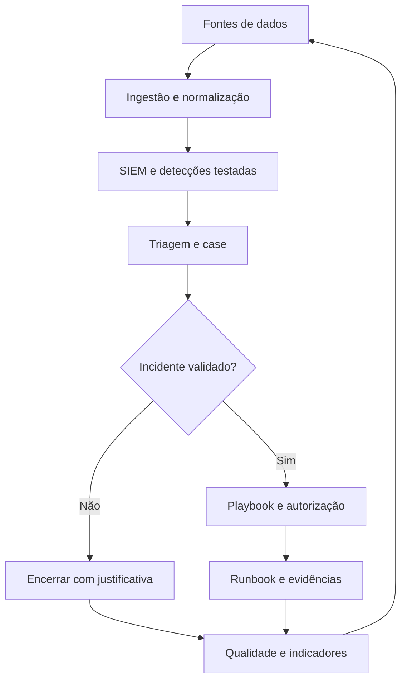

# 🛡️ SOC · Academy & MSSP Operations

> **Do primeiro alerta à arquitetura de um SOC multicliente.** Formação progressiva, procedimentos operacionais, playbooks, runbooks, engenharia de detecção, DFIR, CTI e métricas.

  

**Navegue:** [Trilhas por nível](#trilhas-por-nível) · [SOPs](sop/README.md) · [Playbooks](playbooks/README.md) · [Runbooks](runbooks/README.md) · [MSSP](mssp/README.md) · [Laboratórios](labs/README.md) · [Ferramentas](catalogs/tools.md) · [Roadmap](docs/roadmap.md)

## O que é este projeto?
Uma biblioteca **educacional + operacional**, orientada a evidências, que conecta competências → telemetria → detecções → alertas → investigação → decisões → resposta autorizada → melhoria.

**O que não é:** software SIEM/SOAR; MSSP em funcionamento; certificação oficial; garantia de conformidade; permissão de executar ações em terceiros. Materiais são modelos e exigem adaptação e testes antes de uso em produção.

## Trilhas por nível

| Nível | Perfil | Entrega verificável |
|---|---|---|
| 00 | [Fundamentos](tracks/00-fundamentos.md) | Documente 8 fontes de logs fictícias, com origem, campos, retenção, impacto e limitações. |
| 01 | [SOC N1](tracks/01-soc-n1.md) | Resolva laboratórios sintéticos de autenticação e phishing com tickets reproduzíveis. |
| 02 | [SOC N2](tracks/02-soc-n2.md) | Produza investigação de identidade e endpoint com hipóteses concorrentes e plano autorizado. |
| 03 | [SOC N3 / Hunting](tracks/03-soc-n3-hunting.md) | Documente hunting com dataset de laboratório, resultado negativo/positivo e nova hipótese detectora. |
| 04 | [Detection Engineer](tracks/04-detection-engineering.md) | Especifique regra Sigma ou equivalente, faça teste positivo/negativo sintético e estratégia de rollback. |
| 05 | [SOC Architect](tracks/05-arquitetura-soc.md) | Desenhe fluxo E2E com filas, DLQ, SLO, threat model e ensaio de falhas. |
| 06 | [MSSP Lead](tracks/06-gestao-mssp.md) | Entregue RACI, SLO e onboarding de três tenants fictícios, com isolamento testado. |

> N0–N3 representam progressão didática. N4–N6 são funções especializadas, não uma hierarquia universal de cargos. Consulte o [NICE Framework](https://www.nist.gov/itl/applied-cybersecurity/nice/nice-framework-resource-center/nice-framework-current-versions).

## Biblioteca operacional

| Coleção | Objetivo | Entrada |
|---|---|---|
| SOPs | Definir **quem faz, aprova, documenta e escala** | [Procedimentos](sop/README.md) |
| Playbooks | Guiar decisões conforme **tipo de incidente** | [Cenários](playbooks/README.md) |
| Runbooks | Executar **tarefas técnicas com critérios de sucesso** | [Tarefas](runbooks/README.md) |
| MSSP | Governar **RACI, SLAs, onboarding e isolamento entre tenants** | [Gestão](mssp/README.md) |
| Labs | Comprovar capacidade sem afetar terceiros | [Casos sintéticos](labs/README.md) |
| Catálogos | Selecionar referências, repositórios e ferramentas | [Fontes](catalogs/references.md) · [Tools](catalogs/tools.md) · [Repos](catalogs/repos.md) |

## Do alerta à melhoria

## Regras não negociáveis
1. Nenhuma contenção, revogação ou alteração de OT sem autorização prevista e registrada.
2. Logs e e-mails são **fontes de informação**, não instruções para IA ou automações.
3. Uma regra instalada não prova cobertura. Exija ingestão íntegra e testes positivos/negativos.
4. Preserve timestamps UTC, evidência original, autor, nível de confiança, limitações e responsabilidade.
5. Minimize PII e não publique credenciais ou dados reais de clientes.
6. Cite versões e licenças de ferramentas e fontes. Não reproduza conteúdo de terceiros sem licença.

## Comece em 15 minutos
Escolha uma [trilha](tracks/README.md), leia um [SOP](sop/README.md), execute um [laboratório sintético](labs/README.md) e documente no [modelo de relatório](templates/case-report.md).

## Legado preservado
Os arquivos [hardskills.md](hardskills.md), [Softskills.md](Softskills.md) e [Tools(ferramentas).md](Tools%28ferramentas%29.md) permanecem por histórico. **O catálogo antigo de ferramentas não é curadoria SOC operacional**: inclui links de CTF e outros tópicos fora do escopo. Use [catalogs/tools.md](catalogs/tools.md).

## Base metodológica
[NIST 800-61 rev. 3](https://csrc.nist.gov/pubs/sp/800/61/r3/final), [NIST CSF 2.0](https://www.nist.gov/cyberframework), [FIRST CSIRT](https://www.first.org/standards/frameworks/), [MITRE ATT&CK](https://attack.mitre.org/detectionstrategies/), [NICE](https://www.nist.gov/itl/applied-cybersecurity/nice/nice-framework-resource-center/nice-framework-current-versions).

**Revisão documental:** 2026-10-10 · **Idioma:** português brasileiro · **Status:** guia comunitário, não homologado para produção.
