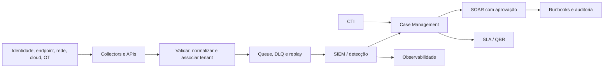

# Arquitetura SOC e MSSP de referência

## Controles obrigatórios
- Identidade de tenant acompanha evento, índice, consulta, ticket, anexos, export e backup.
- Testes negativos de consulta cross-tenant. Não confiar só no seletor de clientes na UI.
- Menor privilégio, SSO/MFA, chaves segregadas, trilha de alterações, secrets manager.
- Fila de erros, retry, replay idempotente, latência end-to-end, integridade e retenção contratual.
- Mudanças disruptivas sempre dependem de aprovações do cliente e do time responsável.
- Para OT, preservar disponibilidade e segurança física; não executar scans ativos sem procedimento formal.

## Ameaças à própria plataforma
Credencial comprometida, fluxo SOAR acionando tenant errado, alteração silenciosa de regras, falta de logs, falha de parser, backup mal segregado, export indevido.

## Testes de aceite
Teste sintético por tenant; case roteado corretamente; negatividade cross-tenant; cenário de falha e retomada com gaps documentados; handover e relatório com origem verificável.
